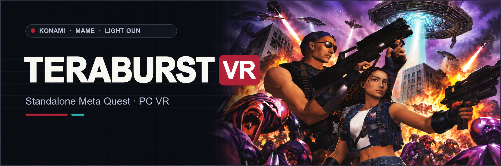

# Teraburst VR

**Konami's alien-invasion lightgun arcade game, rebuilt for stereo VR with tracked guns.** Play on standalone **Meta Quest 3 / 3S** or **Windows PC VR through OpenXR**. The world uses the game's original submitted Voodoo geometry; the arcade HUD remains a separate layer.

[**Download the latest release**](https://github.com/vr4all-standalone/teraburst-vr/releases/latest) · [Setup and controls](#getting-started) · [Buildable source](#status-and-source-code) · [Validation](docs/TESTING.md)

## Downloads

| Platform | Download |
| --- | --- |
| Meta Quest 3 / 3S | [teraburst-vr-quest.apk](https://github.com/vr4all-standalone/teraburst-vr/releases/latest/download/teraburst-vr-quest.apk) |
| Windows PC VR / OpenXR | [teraburst-vr-pcvr.zip](https://github.com/vr4all-standalone/teraburst-vr/releases/latest/download/teraburst-vr-pcvr.zip) |
| Complete matching source | [teraburst-vr-source.zip](https://github.com/vr4all-standalone/teraburst-vr/releases/latest/download/teraburst-vr-source.zip) |
| Download verification | [SHA256SUMS.txt](https://github.com/vr4all-standalone/teraburst-vr/releases/latest/download/SHA256SUMS.txt) |

**Bring your own game data. No ROMs, CHDs or extracted game assets are included.** The supported set is **Teraburst, July 17, 1998 US UEL**, MAME short name **`terabrst`**. It needs the complete validated `terabrst.zip`; **no CHD or separate BIOS is required**. Renaming a `.7z` file to `.zip` will not work.

## What's included

- Native stereo 3D scenery with independent **World size**, **3D strength** and **Stereo separation** controls.
- Tracked guns and scenery-aware lasers, with the original reticles placed at the physical 3D hit point.
- **P1 blue / P2 red** lasers matching the original reticle colours. Default paired hands: **P1 left / P2 right**.
- Solo play and explicit two-player joining. Choosing a hand layout does not join P2; the second gun waits for the game's acknowledgement.
- Automatic-fire recoil, muzzle flash, smoke and repeated haptics.
- The original tutorial rifle, loaded from the user's game data at runtime, plus Arcade and Zapper choices.
- Three-credit Start buttons and automatic first-launch RTC initialization.
- Purple VR4ALL settings, controller help, recentering and native service controls.

The FPS display is **Off** for normal play. Preview installations migrate the temporary overlay off while keeping saved calibration and controls. Detailed support logs remain available, and the counter can be enabled manually in settings.

## Getting started

### Meta Quest

1. Install `teraburst-vr-quest.apk` with your usual sideloading tool or ADB.
2. Put your complete **`terabrst.zip`** in the headset's **Download** folder.
3. Open **Teraburst VR** from Unknown Sources, allow the requested game-file access and keep both Touch controllers awake.
4. Setup checks the actual game-file sizes and hashes, then starts VR. The initial RTC warning is handled automatically.
5. Press **A** to add three credits and start P1. Press **X** to add three credits and request P2 after P1 has started.

An update installs over the preview with the same signing identity and preserves game data, saves and preferences. Exit normally to save native clock/operator state.

### Windows PC VR

1. Extract `teraburst-vr-pcvr.zip`.
2. Put the owned **`terabrst.zip`** in a **`roms`** folder beside the launcher.
3. Select your usual PC OpenXR runtime, connect your headset/controllers and run **Run Teraburst VR.cmd**.

For another game-file folder, run `launch-pcvr.ps1 -RomDirectory PATH`. The launcher verifies the set and keeps writable state in `userdata`, separate from the game files. The Windows build and production OpenGL checks pass; a physical PCVR-headset playtest is still pending.

## Controls

| Control | Action |
| --- | --- |
| A / right controller in Solo | Three credits, then P1 Start |
| X / left controller in Solo | Three credits, then request P2 |
| Trigger | Fire; a fresh pull transfers the solo gun to that hand |
| B / Y | Native bomb |
| Left Menu | VR settings |
| Left stick click | Recenter |
| Right stick click | Toggle laser |
| Grip + stick | Adjust world size vertically or gun size horizontally |

Once paired, Start follows the selected player-hand layout. The default is **P1 left / P2 right**; the opposite layout and Solo are available. An automatic join layout is session-only; an explicitly chosen layout is saved. Teraburst has native bombs and continuous fire; no offscreen reload is invented.

### 3D settings

**Stereo 3D** is the default background. **Original** presents the native raster on a panel. A useful tested profile is **3D strength 1.75x** and **Stereo separation 1.5x**, with the normal world-size setting. Existing preferences are retained. Strength defaults to 1.5x and separation to 1x for fresh installs; increase them to taste.

World size, depth and disparity are separate controls. Very strong separation can suggest miniature scale or apparent scene motion. The native tile HUD, boot screens and operator menus remain flat. The game only supplies scenery from its arcade camera: leaning outside it can expose gaps, and wider view is unavailable.

### Service controls

Routine startup is automatic. For operator settings, use **Open Service Menu**. The stick sends Start1/Start2 for up/down, trigger selects, and B/Y sends Test. Choose the arcade's **GAME MODE** when needed, then **Leave service controls** in VR settings. A stick click switches operator-menu controls to gun-test aiming.

## Status and source code

**v0.1.0 is the first public release.** The user has confirmed improved Quest 3S FPS/audio, stereo depth, gun alignment, lasers/reticles, automatic fire/haptics and player joining. Full routes, every boss and all headset/controller combinations have not been exhaustively tested. Upstream MAME still marks Teraburst `MACHINE_NOT_WORKING` and `MACHINE_IMPERFECT_SOUND`; occasional original emulation faults remain possible. See [validation](docs/TESTING.md).

This repository is the project/download page. The **complete matching buildable source is the release's `teraburst-vr-source.zip`**, including the port, 16 engine patches, a full Git bundle for pinned MAME 0.289 commit `f34f02505e32c1993c6a782b6814232cbfc74e36`, exact SDL/OpenXR dependency sources, SHA256 manifests and notices. GitHub's automatic repository ZIP contains this project page; use the named source asset to build the mod.

See [build instructions](docs/BUILD.md), [credits and licences](CREDITS.md), [LICENSE](LICENSE), and [banner attribution](docs/github/ARTWORK.md). The host/modifications use GPL-2.0-or-later; upstream components retain their own notices. This is an unofficial community VR4ALL port, not a Konami or MAME product.
